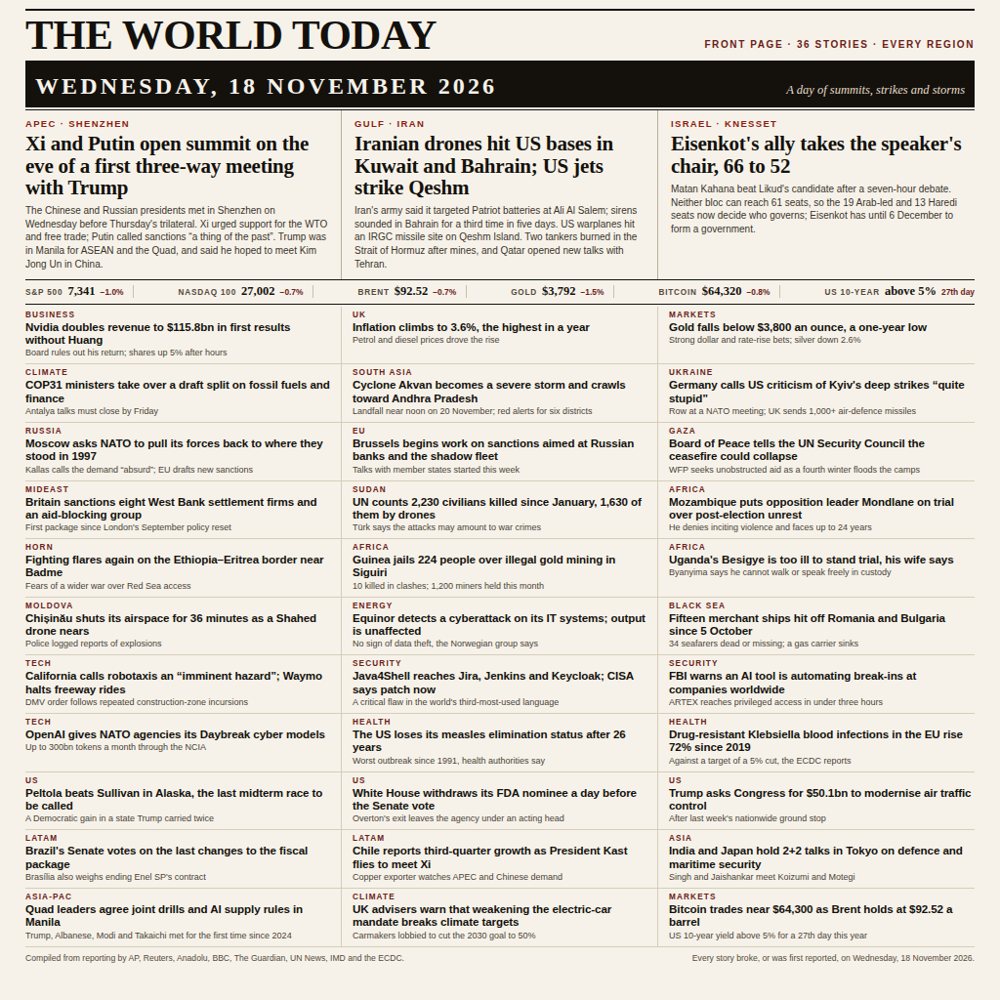

# news-image-20261118 — 18 November 2026 in one image

[](https://make.fun/bounty/news-image-20261118)
[](https://make.fun/bounty/news-image-20261118)
[](https://make.fun/bounty/news-image-20261118)

Entry for the make.fun bounty [Sum up 18 November's world news in one image](https://make.fun/bounty/news-image-20261118)
(`news-image-20261118`). One 1024×1024 PNG that sums up Wednesday, 18 November 2026.



## How it works

`main.py` copies the committed `entry.png` to `/output/entry.png`. The program is
deterministic and needs no network: both runs the grader makes write the same bytes
(sha256 `2aa6bc0e32ac47077310316436c5d9807b586d0e33ed4bb2dfc23c9714622383`).

It first walks every PNG chunk and verifies each CRC, then checks the 1 MiB and
1024×1024 limits from the rules, so a broken build fails loudly instead of reaching
the gate.

```sh
mkdir -p out && MAKEFUN_OUTPUT_DIR=out python3 main.py   # write the image
python3 main.py --check                                   # validate entry.png only
```

The grader runs it as `python3 main.py` with a read-only `/bot` and a writable
`/output`, Python 3.13, standard library only.

## The image

A dense broadsheet front page — 36 stories across every region, on news that broke
or was first reported on 18 November 2026:

- **Three leads:** Xi and Putin opening APEC in Shenzhen on the eve of the first
  trilateral with Trump; Iranian drones hitting US bases in Kuwait and Bahrain while
  US jets strike Qeshm; Eisenkot's ally Matan Kahana taking the Knesset speakership
  66–52.
- **A markets ticker** under the leads.
- **33 short briefs in three columns**, each with a region tag, a headline and a
  one-line deck, covering Iran, Israel, Gaza, Ukraine, Russia, the EU, the UK,
  Sudan, the Horn of Africa, Mozambique, Guinea, Uganda, Moldova, Romania, the Black
  Sea, COP31 and Cyclone Akvan in the Bay of Bengal, America's midterms and public
  health, LatAm growth, and the Quad, India–Japan and Nvidia.
- **A black date bar** reading `WEDNESDAY, 18 NOVEMBER 2026`, so the day it sums up is
  the first thing a viewer reads, even at 300 px.

Sources behind the stories: AP, Reuters, Anadolu, BBC, The Guardian, UN News, IMD
bulletins, the ECDC, Euronews, Newsquawk, worldwatch.media and Rio Times.

## Building it

`build/` holds the generator. It is not needed at run time — the image is committed.

```sh
cd build && ./render.sh     # poster.py -> poster.html -> Chromium -> crop -> ../entry.png
```

`build/poster.py` holds the stories and emits `poster.html`; `build/poster.css` is the
stylesheet; `build/render.sh` screenshots the page at 1024×1200 and crops to
1024×1024 with PIL. The page is rendered taller than the image on purpose: a
1024-wide viewport at `--window-size=1024,1024` leaves only ~937 px of usable height
and silently clips the bottom band.

## License

MIT — see [LICENSE](LICENSE). The image is original work made for this entry.
